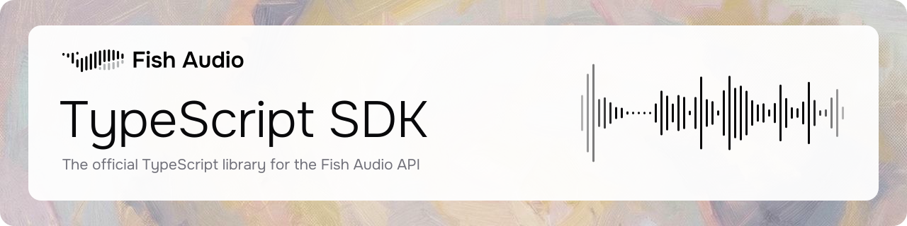

<picture>
  <source media="(prefers-color-scheme: dark)" srcset="https://raw.githubusercontent.com/fishaudio/fish-audio-typescript/refs/heads/main/.github/assets/banner-dark.svg" />
  
</picture>

# Fish Audio Typescript SDK

To provide convenient Typescript program integration for [https://docs.fish.audio](https://docs.fish.audio)

## Install

```bash
npm install fish-audio
```

## Usage

Initialize a `FishAudioClient` to use APIs. Authenticate by setting `FISH_API_KEY="your_api_key"`
in your environment or pass it in.

Get your API key from [fish.audio/app/api-keys](https://fish.audio/app/api-keys/?utm_source=github&utm_medium=sdk-readme&utm_content=typescript).

```typescript
import { FishAudioClient } from "fish-audio";

const fishAudio = new FishAudioClient();
```

Sometimes, you may need to change our endpoint to another address. You can use

```typescript
import { FishAudioClient } from "fish-audio";

const fishAudio = new FishAudioClient({apiKey: "your_api_key", baseUrl: "https://your-proxy-domain"});
```

### Text to Speech

`convert` takes an optional second argument for the model name. It defaults to `"s2.1-pro"`; pass any other supported name when you need it.

| Model | Notes |
| --- | --- |
| `s2.1-pro` | Current flagship (default) |
| `s2.1-pro-free` | Free tier of `s2.1-pro` |
| `drama-3` | Expressive model you direct in plain language |
| `s2-pro` | Previous generation |
| `s1` | Deprecated, retires on 2026-12-31 |

```typescript
import { FishAudioClient, play } from "fish-audio";

const fishAudio = new FishAudioClient({ apiKey: "your_api_key" });

const request = { text: "Hello, world!" };
const audio = await fishAudio.textToSpeech.convert(request); // defaults to "s2.1-pro"

await play(audio);

const drama = await fishAudio.textToSpeech.convert(request, "drama-3");
```

#### Reference Audio

```typescript
import type { TTSRequest } from "fish-audio";

const request: TTSRequest = {
    text: "Hello, world!",
    reference_id: "your_model_id",
};
```

Or pass `ReferenceAudio` for zero-shot cloning:

```typescript
import { File } from "node:buffer";
import { readFile } from "fs/promises";
import type { ReferenceAudio, TTSRequest } from "fish-audio";

const audioBuffer = await readFile("path/to/your/audio/file.mp3");
const referenceFile = new File([audioBuffer], "audio_file_name.mp3");

const referenceAudio: ReferenceAudio = {
    audio: referenceFile,
    text: "reference audio text"
};

const request: TTSRequest = {
    text: "Hello, world!",
    references: [referenceAudio]
};
```

#### Multi-speaker (S2 family)

Pass an array of voice IDs and mark speaker turns in the text. This requires `s2-pro` or `s2.1-pro`, not `s1`.

```typescript
const request: TTSRequest = {
    text: "<|speaker:0|>Hello!<|speaker:1|>Hi there!",
    reference_id: ["speaker-a-id", "speaker-b-id"],
};

const audio = await fishAudio.textToSpeech.convert(request, "s2.1-pro");
```

#### WebSocket

The TTS websocket provides real-time streaming.

```typescript
import { FishAudioClient, RealtimeEvents } from "fish-audio";
import { writeFile } from "fs/promises";
import path from "path";

// Simple async generator that yields text chunks to speak
async function* makeTextStream() {
    const chunks = [
        "Hello from Fish Audio! ",
        "This is a realtime text-to-speech test. ",
        "We are streaming multiple chunks over WebSocket.",
    ];
    for (const chunk of chunks) {
        yield chunk;
        await new Promise((r) => setTimeout(r, 200));
    }
}

const client = new FishAudioClient();

// For realtime, set text to "" and stream the content via textStream instead
const request = {
    text: "",
    reference_id: "your_model_id"
};

// Defaults to backend: "s2.1-pro"
const connection = await client.textToSpeech.convertRealtime(request, makeTextStream());

// Collect audio and write to a file when the stream ends
const chunks: Buffer[] = [];
connection.on(RealtimeEvents.OPEN, () => console.log("WebSocket opened"));
connection.on(RealtimeEvents.AUDIO_CHUNK, (audio: unknown): void => {
    if (audio instanceof Uint8Array || Buffer.isBuffer(audio)) {
        chunks.push(Buffer.from(audio));
    }
});
connection.on(RealtimeEvents.ERROR, (err) => console.error("WebSocket error:", err));
connection.on(RealtimeEvents.CLOSE, async () => {
    const outPath = path.resolve(process.cwd(), "out.mp3");
    await writeFile(outPath, Buffer.concat(chunks));
    console.log("Saved to", outPath);
});
```

### Speech to Text (ASR)

```typescript
import { FishAudioClient } from "fish-audio";
import { createReadStream } from "fs";

const fishAudio = new FishAudioClient();

const audioFile = createReadStream("/path/to/your/audio/file");

try {
    const result = await fishAudio.speechToText.convert({
        audio: audioFile,
    });

    console.log("Transcription:", result.text);
    console.log("Duration (s):", result.duration);
    console.log("Segments:", result.segments);
} catch (err) {
    console.error("STT request failed:", err);
}
```

Unless a `model` header is configured, `convert` runs on the API's default model, `transcribe-1`. Pass `model` to choose another one, such as `transcribe-1-pro`; it takes precedence over a `model` header:

```typescript
const result = await fishAudio.speechToText.convert({
    audio: audioFile,
    model: "transcribe-1-pro",
});
```

#### Realtime (Preview)

`convertRealtime` streams live audio to `transcribe-stream-1` over a WebSocket and returns the transcript turn by turn. Send 16-bit little-endian mono PCM in chunks of 20–40 ms as you capture it. The returned stream is an async iterable of events; narrow them by `type`.

```typescript
import { FishAudioClient } from "fish-audio";
import { createReadStream } from "fs";

const fishAudio = new FishAudioClient();

// Raw 16-bit mono PCM at 16 kHz, 40 ms (1280 bytes) per chunk.
// From a file this sends faster than real time; a microphone yields chunks as it captures them.
async function* audioChunks() {
    yield* createReadStream("speech.pcm", { highWaterMark: 1280 });
}

// diarize: false gives plain text. By default the text starts with a speaker tag: "<|speaker:0|> Hello."
const stream = fishAudio.speechToText.convertRealtime(
    { sample_rate: 16000, drafts: true, diarize: false },
    audioChunks(),
);

for await (const event of stream) {
    if (event.type === "draft") {
        console.log("...", event.text); // live text of the open turn, not final
    } else if (event.type === "committed") {
        console.log(event.text); // final transcript of the turn
    }
}
```

The session ends with a `session_done` event once the audio source is exhausted. Leaving the loop early, or calling `stream.close()`, closes the connection.

When the session ends for any reason, the stream calls `return()` on the audio source's iterator and does not wait for it, so `close()` never hangs on the source. An async generator that is suspended on a read cannot be interrupted this way: its `return()` only runs after that read settles. If your source can block, such as a microphone, give it an `AbortSignal` and abort it when you are done with the session:

```typescript
async function* microphone(signal: AbortSignal) {
    const recorder = openRecorder(); // your own capture code
    try {
        while (!signal.aborted) {
            let stop!: () => void;
            const aborted = new Promise<undefined>((resolve) => {
                stop = () => resolve(undefined);
            });
            signal.addEventListener("abort", stop, { once: true });
            let chunk: Uint8Array | undefined;
            try {
                // read() resolves with the next 20–40 ms of PCM.
                chunk = await Promise.race([recorder.read(), aborted]);
            } finally {
                signal.removeEventListener("abort", stop);
            }
            if (chunk === undefined) {
                break; // aborted while waiting for audio
            }
            yield chunk;
        }
    } finally {
        recorder.close(); // releases the device, and a read that is still pending
    }
}

const controller = new AbortController();
const stream = fishAudio.speechToText.convertRealtime({ diarize: false }, microphone(controller.signal));
try {
    for await (const event of stream) {
        if (event.type === "committed") console.log(event.text);
    }
} finally {
    controller.abort(); // stops the microphone, however the loop ended
}
```

Racing the read only stops the generator from waiting; it is `recorder.close()` in the `finally` block that stops the capture, so release your device there. `controller.abort()` on its own ends the audio: the session then finishes with `session_done`, as it does when the source is exhausted.

The stream also sends control messages while the session runs:

```typescript
await stream.finalize(); // commit the open turn now (push-to-talk, with turn_detection: "manual")
await stream.agentSpeaking(true); // voice agents: your agent started speaking
await stream.addContext([{ role: "assistant", text: "Which day works for you?" }]);
await stream.configure({ turn_detection: { mode: "vad", silence_timeout_ms: 900 } });
await stream.keepalive(); // a session closes after 30 seconds without any client message
```

Errors are thrown from the loop:

- `RealtimeSTTError` when the server ends the session or the connection is lost. It carries `errorType` (such as `unsupported_audio`), `statusCode`, `requestId` and the WebSocket `closeCode`.
- `UnauthorizedError`, or `FishAudioError` with a `statusCode` such as 402 or 429, when the connection is refused.
- The audio source's own error when the audio source throws.

An error the session survives arrives as an `error` event with `recoverable: true` instead.

`convertRealtime` runs in Node.js only, like the TTS WebSocket: browsers cannot set the `Authorization` header on a WebSocket.

[Learn more](https://docs.fish.audio/features/speech-to-text/realtime)

### Voices

#### Clone a Voice
```typescript
import { FishAudioClient } from "fish-audio";
import { createReadStream } from "fs";

const fishAudio = new FishAudioClient();

const title = "cloned-voice-name";
const audioFile = createReadStream("/path/to/your/audio/file");
const coverImageFile = createReadStream("/path/to/your/cover/image/file");

try {
    const response = await fishAudio.voices.ivc.create({
        title: title,
        voices: [audioFile],
        cover_image: coverImageFile,
    });

    console.log("Voice created:", {
        id: response._id,
        title: response.title,
        state: response.state,
    });
} catch (err) {
    console.error("Create voice request failed:", err);
}
```

#### List models

```typescript
fishAudio.voices.search()
```

#### Get a model info by id

```typescript
fishAudio.voices.get("your_model_id")
```

#### Update a model

```typescript
fishAudio.voices.update("your_model_id", { title: "new_title" })
```

#### Delete a model

```typescript
fishAudio.voices.delete("your_model_id")
```

### User

#### Get User API Credits

```typescript
fishAudio.user.get_api_credit()
```

#### Get User Package
```typescript
fishAudio.user.get_package()
```
